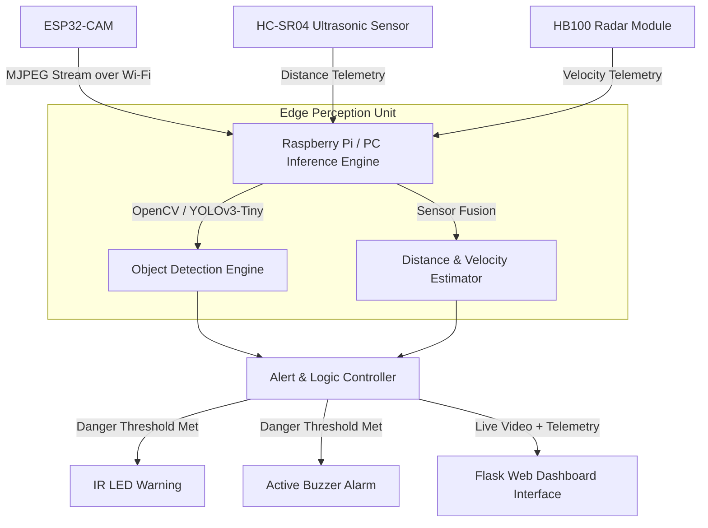

# ADAS-Plus System Architecture

## 🏗️ Architectural Overview

**ADAS-Plus** follows a multi-tier edge perception architecture:

## 🧠 Data Processing Flow

1. **Video Stream Processing**: Frames are pulled from the ESP32-CAM MJPEG stream (`http://<ESP32_IP>:81/stream`), decoded using OpenCV, and resized to input resolution (192x192 / 320x240).
2. **Object Detection**: YOLOv3-Tiny predicts bounding boxes, confidence scores, and class labels (vehicles, pedestrians, obstacles).
3. **Sensor Fusion**: Ultrasonic and Radar metrics are combined with visual bounding box size to estimate proximity and collision hazard level.
4. **Alert Triggering**: Proximity below threshold activates IR warning LEDs, active buzzers, and UI red danger flags.
