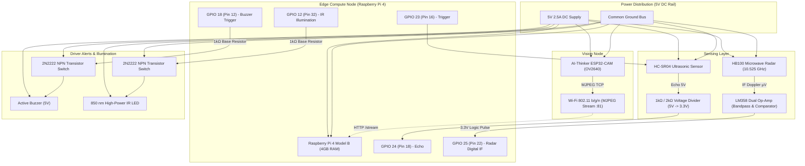

# ADAS+ Electrical Schematics & Circuit Architecture

This directory documents the electrical design, signal levels, and schematic connections for the ADAS+ prototype.

---

## System Architecture Diagram

---

## Circuit Subsystems & Level Shifting

### 1. Ultrasonic Echo Voltage Divider
The HC-SR04 operates at **5V VCC** and outputs a **5V logic pulse** on the `ECHO` pin. Connecting this directly to the Raspberry Pi GPIO (which is strictly 3.3V tolerant) would damage the SoC. A resistor divider drops the signal safely:

$$\mathrm{V_{GPIO}} = \mathrm{V_{ECHO}} \times \frac{R_2}{R_1 + R_2} = 5.0\,\mathrm{V} \times \frac{2000\,\Omega}{1000\,\Omega + 2000\,\Omega} = 3.33\,\mathrm{V}$$

- **R1** (Upper): $1.0\,\mathrm{k}\Omega \pm 1\%$
- **R2** (Pulldown to GND): $2.0\,\mathrm{k}\Omega \pm 1\%$ (or $2 \times 1.0\,\mathrm{k}\Omega$ in series)

---

### 2. HB100 Microwave Radar IF Conditioning
The HB100 module outputs intermediate frequency (IF) microvolt Doppler shifts (~10–30 Hz for walking/vehicle motion). An **LM358 dual operational amplifier** is configured as:
1. **Stage 1**: Active bandpass pre-amplifier (~2 Hz to 100 Hz, gain ~1000).
2. **Stage 2**: Voltage comparator with threshold potentiometer ($V_{\mathrm{ref}} \approx 1.65\,\mathrm{V}$) converting analog Doppler sinusoidal waves into clean 3.3V digital pulses for Raspberry Pi GPIO 25.

---

### 3. Actuator Transistor Switching Circuits
The Raspberry Pi GPIO pins source a maximum of **16 mA per pin**, which cannot directly drive the 5V active buzzer (~30 mA) or the high-power 850 nm infrared night illuminator (~100–150 mA). 

Both actuators use a **2N2222 NPN BJT switch**:
- **Base**: Connected to Raspberry Pi GPIO through a $1\,\mathrm{k}\Omega$ current-limiting resistor ($I_B \approx 2.6\,\mathrm{mA}$).
- **Collector**: Connected to actuator negative terminal (actuator positive is on +5V rail). A flyback diode (1N4148) is placed across inductive buzzer terminals.
- **Emitter**: Connected directly to ground bus (`GND`).

---

## Full Pin Reference Table

| Peripheral | Board Pin | Raspberry Pi GPIO | Logic Voltage | Protection / Driver |
|---|---|---|---|---|
| Active Buzzer (+) | Pin 12 | GPIO 18 | 3.3V Logic | 2N2222 NPN Switch + 1kΩ Base Resistor |
| HC-SR04 Trigger | Pin 16 | GPIO 23 | 3.3V Logic | Direct Pi output to 5V HC-SR04 Trig |
| HC-SR04 Echo | Pin 18 | GPIO 24 | 3.3V Input | 1kΩ / 2kΩ Voltage Divider (Protected) |
| HB100 Radar IF | Pin 22 | GPIO 25 | 3.3V Input | LM358 Comparator Digital Output |
| 850 nm IR LED (+) | Pin 32 | GPIO 12 | 3.3V Logic | 2N2222 NPN Switch + 10Ω Current Resistor |
| 5V DC Bus | Pin 2 & 4 | — | 5.0V DC | 2.5A Regulated Power Supply Rail |
| Ground Bus | Pin 6, 9, 14, 20 | — | 0V | Common Ground Plane |
